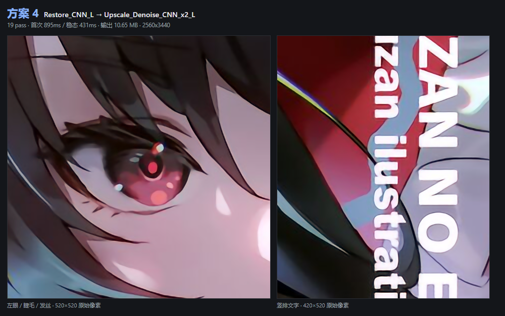
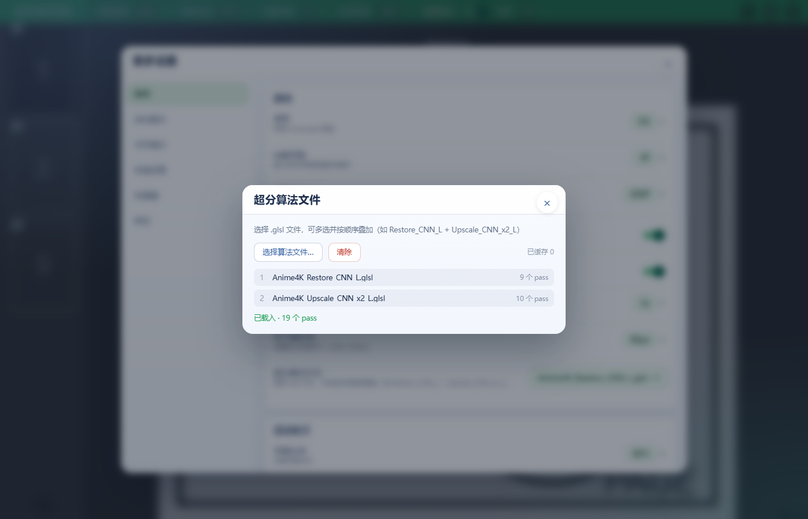
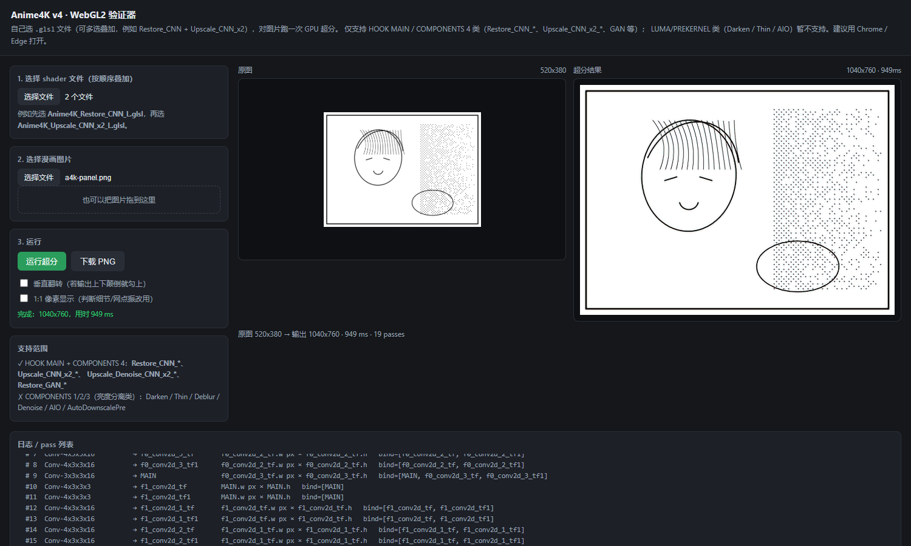
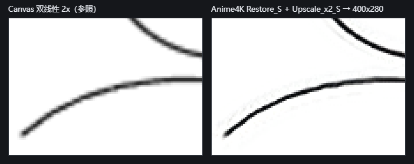
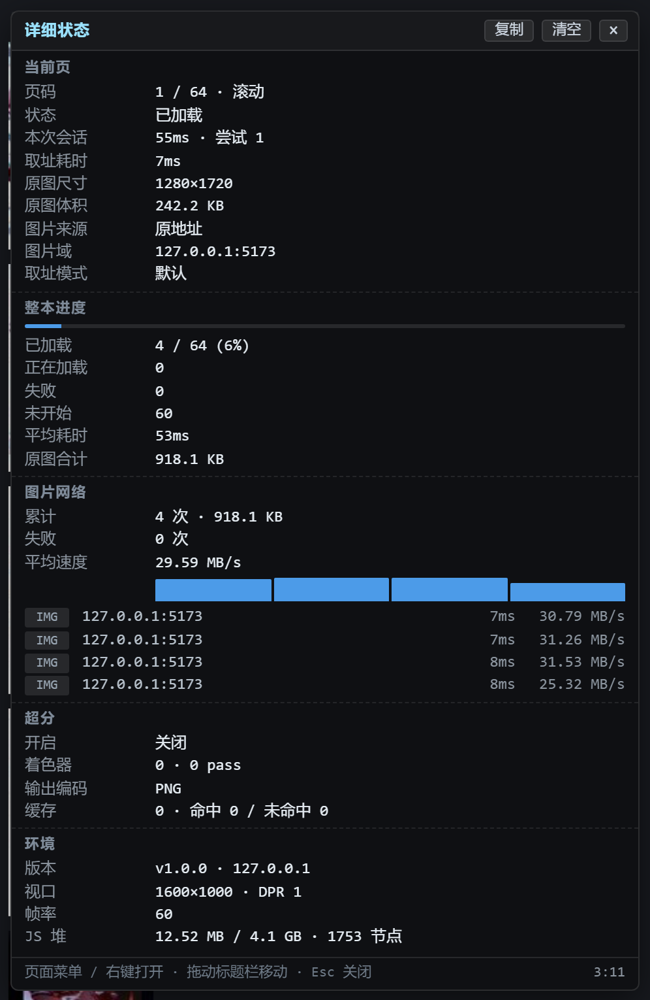

# eHunter Enhanced

[中文版](README_CN.md)

An enhanced fork of [hanFengSan/eHunter](https://github.com/hanFengSan/eHunter) (based on `master@43a0a13`). Keeps the original scroll / book reader and adds **WebGL2 super-resolution**, a **detailed runtime stats overlay**, **pixiv support**, and more. Current version **v1.0.0**.

Original author Alex Chen, Copyright (c) 2017 Alex, MIT licensed (see [LICENSE](LICENSE)). This fork uses its own `@name` / `@namespace`, so it **can be installed alongside the original** without overwriting it.

## Install

Download `ehunter-enhanced.user.js` from [Releases](https://github.com/KniphH/eHunter/releases) and install it in Tampermonkey / Violentmonkey. Supported sites: e-hentai, exhentai, nhentai, pixiv.

The script requires `GM_xmlhttpRequest` (image fallback) and `GM_download` (bundle download).

## Added features

| Feature | Where | What it does |
| --- | --- | --- |
| Super-resolution | More settings → Super resolution | Upscales the current page in WebGL2 with shaders you choose |
| Shader files | More settings → Super resolution shaders | Load, reorder and clear `.glsl` files; inspect the pass chain |
| Output encoding | More settings → Output encoding | PNG / WebP / JPEG — trade latency against memory |
| Detailed stats | Page menu → "Detailed stats", or right-click in the reader | Five-section runtime overlay with render breakdown and network detail |
| pixiv platform | Automatic on artwork pages | Multi-page illustrations, R-18 and follower-only works |
| Image fallback channel | Automatic | GM request with Referer and magic-byte validation when `` fails |
| Retry policy | Automatic | Round-robin retry; original-source mode never auto-retried |

<p align="center"></p>

*Figure 1. Detail from an upscaled 2560×3440 colour page: eye linework, hair strands and vertical text.*

---

## 1. Super-resolution

### Setup

1. Enable **More settings → Super resolution**. On first enable with no shaders loaded, the shader picker opens automatically.
2. Click **Super resolution shaders → Choose files…** and pick one or more `.glsl` / `.hook` / `.txt` files. **No algorithm is bundled**: shader text is stored locally (`GM_getValue`/`GM_setValue` when the userscript manager provides them, otherwise page `localStorage`) and restored on next launch.
3. Use the ▲▼ buttons to reorder. Files run **top to bottom** — the first ("First") runs first, the last ("Last") finishes. The dialog shows per-file pass counts, total passes, the full chain, and how many pages are cached.

<p align="center"></p>

*Figure 2. The shader file dialog: two `.glsl` files, 19 passes total, reorderable.*

### Supported shader form

| | Scope |
| --- | --- |
| Supported | `//!HOOK MAIN` + `//!COMPONENTS 4`: `Restore_CNN_*`, `Upscale_CNN_x2_*`, `Upscale_Denoise_CNN_x2_*`, `Restore_GAN_*` |
| Not supported | `//!COMPONENTS 1/2/3` luma-only filters (Darken / Thin / Deblur / AIO). Loading fails **loudly** rather than producing a wrong image |

This is a WebGL2 port of libplacebo hook semantics, not mpv shaders passed through unchanged: `//!WIDTH` / `//!HEIGHT` are evaluated as postfix expressions using `NAME.w` / `NAME.h`; `//!BIND HOOKED` is an alias for MAIN; `//!SAVE` textures flow between passes; each bound texture gets `NAME_tex`, `NAME_texOff`, `NAME_pos`, `NAME_size` and `NAME_pt` macros. Chromium ignores `UNPACK_FLIP_Y_WEBGL` for `ImageBitmap`, so the runner flips Y itself.

### How it runs

- Decode source into an `ImageBitmap` → render pass by pass into textures → present the final pass to a canvas → `toBlob` → replace `` with a blob URL.
- **LRU cache of 8 pages**; the same URL is rendered once (in-flight calls are coalesced), prefetch is supported, and going back hits the cache.
- Any failure (shader compile, size expression, `MAX_TEXTURE_SIZE`, encoding) marks the URL as failed and **falls back to the original address** — no broken images. A `blob:` URL is not mistaken for an already-upscaled result.
- Changing the encoding or the shader set clears the cache and revokes blob URLs, so stale results cannot linger.

<p align="center"></p>

*Figure 3. WebGL2 validator: 520×280 source → 1040×760 output, 19 passes, ~949 ms; intermediate textures are listed below.*

### Output encoding

Measured on one real 2560×3440 colour page (RTX 3050 Laptop / ANGLE D3D11):

| Encoding | Size | Encode | Decode | Trade-off |
| --- | --- | --- | --- | --- |
| PNG (default) | 11.27 MB | 355 ms | 114 ms | Lossless, ~2× faster to encode than WebP, but heaviest: ~90 MB for 8 cached pages |
| WebP 0.9 | 0.55 MB | 677 ms | 70 ms | ~1/20 the size and fastest to decode, at ~0.3 s extra encoding per page |
| JPEG 0.9 | 0.93 MB | 75 ms | 32 ms | Fastest and lightest, but lossy — fine lines and small text pick up artifacts |

No option dominates, so it is user-selectable. There is deliberately no quality slider: each option fixes one measured quality value rather than adding a knob that looks adjustable but makes no visible difference.

<p align="center"></p>

*Figure 4. The same curve at 2×: canvas bilinear (left) vs Anime4K Restore + Upscale (right). Thin edges make algorithm differences easiest to see.*

---

## 2. Detailed stats overlay

### Opening and controls

<p align="center"></p>

*Figure 5. The overlay in the local 64-page test environment (super-resolution off in this shot): current page / album progress / image network / super-resolution / environment, all from live sampling.*

- **Open**: page menu → "Detailed stats", or **right-click** inside the reader.
- **Close**: `Esc` or the × button.
- Drag the title bar to move the panel. "Copy" exports the panel as plain text for bug reports; "Reset" clears the counters.

### Five sections

| Section | Fields |
| --- | --- |
| Current page | Index, status, source mode, attempts, session duration, fetch time, original size / bytes, upscaled size / bytes and ratio, displayed image origin (URL / thumbnail / fallback blob / upscaled result), image host, last error |
| Album progress | Loaded / total with percentage, loading, failed, not started, average load time, total original bytes, total upscaled bytes (with page count) |
| Image network | Total requests and bytes, failures, average speed; 12-bar speed chart plus the last 5 samples (`IMG` / `GM` / `SR` channel, host, duration, speed, failure reason) |
| Super-resolution | Enabled state, shader file count and total passes, output encoding, full execution chain, cache size and hit rate / queue depth, last render input→output dimensions and byte delta, **render breakdown: decode / GPU / encode / total** |
| Environment | Version and platform, viewport and DPR, FPS, JS heap and DOM node count |

The four breakdown timings add up to the total, so you can see whether the bottleneck is decoding, GPU work or encoding instead of guessing from one number.

### Sampling rules

- **Ring buffers** (48 network requests / 12 renders), no logs, nothing persisted. Sampling continues while the overlay is closed, so opening it shows what just happened.
- The FPS / memory / node probe runs **only while the overlay is open**; closing it stops the rAF loop and timer.
- Sizes and byte counts come in original / upscaled pairs. Anything unavailable shows `—` rather than a guess.
- Cross-origin images without `Timing-Allow-Origin` always report `transferSize` / `decodedBodySize` as 0 from Resource Timing, so original bytes come from the **blob the script fetched itself** (`blob.size`), which is real.
- "Loading" counts sessions actually running now, not a possibly stale Loading flag; "Not started" includes pages never scrolled to and is not a failure count.

---

## 3. Other changes

- **pixiv platform**: detects `/artworks/:id` (including `/en/`), then reads metadata and per-page URLs from same-origin `/ajax/illust/:id` and `/ajax/illust/:id/pages`. Requests carry the current session cookies automatically, so R-18 and follower-only works are readable. Ugoira (animated works) is not supported.
- **Image fallback channel**: when `` fails, a `GM_xmlhttpRequest` retry adds the required `Referer` (`i.pximg.net` returns 403 without it) and exposes the real HTTP status. Returned bytes are validated against PNG / JPEG / GIF / WebP / AVIF magic bytes: a CDN serving an HTML error page with HTTP 200, or a manager returning text instead of binary, is treated as a failure instead of being wrapped in a Blob and shown as a broken image.
- **Retry policy**: a session builds one complete plan and consumes "default source → alternate source" in rounds, instead of rebuilding a queue on every failure (the old behaviour could retry forever on a permanently unavailable image). **Original-source mode is never in the automatic loop** — fetching an original on e-hentai costs GP, so it appears only once, at the front, when the user explicitly picks it. Bulk downloads use a separate forward-only plan, also excluding originals.

---

## Build

```bash
npm install
npm run build-prod    # → dist/ehunter.iife.js
```

The output is an IIFE with the userscript banner. The version lives only in `package.json` and is injected into `__EHUNTER_VERSION__` and `@version` at build time — do not edit the built file.

Files added or substantially changed in this fork:

```
core/service/SuperResolutionService.ts          WebGL2 runner, shader parser, LRU cache
core/service/StatsService.ts                    runtime sampling, aggregation, probe
core/service/ImageFetchService.ts               GM fallback and magic-byte validation
core/service/imageRetryPolicy.ts                retry plan
core/components/StatsOverlay.vue                detailed stats overlay
core/components/dialog/SuperResShaderDialog.vue  shader file management
src/platform/pixiv/                            pixiv platform
```

## License and attribution

MIT. Original project: [hanFengSan/eHunter](https://github.com/hanFengSan/eHunter) by Alex Chen, Copyright (c) 2017 Alex; see [LICENSE](LICENSE). Fork changes are maintained by KniphH. Please file issues [in this repository](https://github.com/KniphH/eHunter/issues), not upstream.
