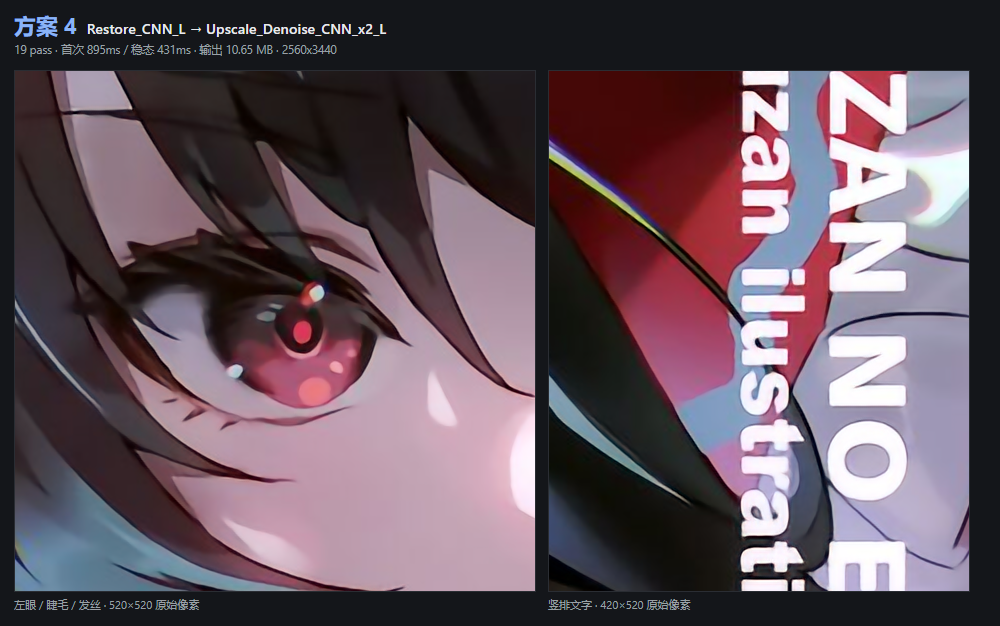
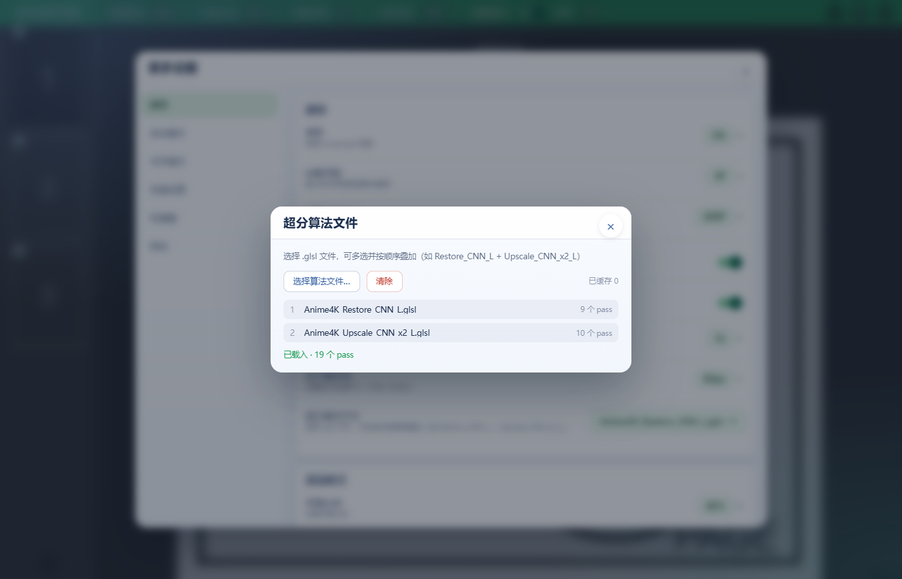
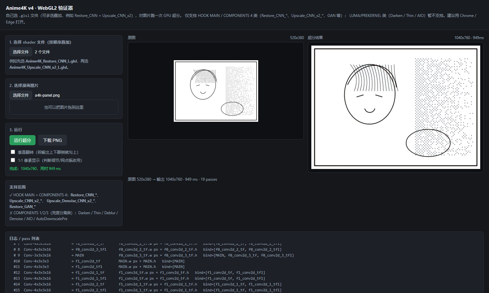
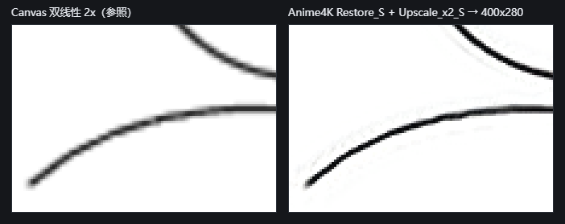
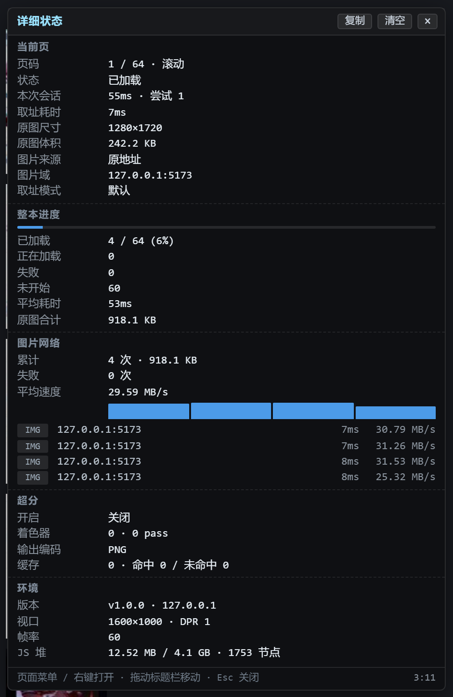

# eHunter Enhanced

基于 [hanFengSan/eHunter](https://github.com/hanFengSan/eHunter) 的增强分支（起点 `master@43a0a13`），保留原有的卷轴式 / 书本式阅读，新增**像素超分**、**详细状态浮层**、**pixiv 平台**等能力。当前版本 **v1.1.0**。

原作者 Alex Chen，Copyright (c) 2017 Alex，MIT 许可（见 [LICENSE](LICENSE)）。本分支使用独立的 `@name` / `@namespace`，**可与原版同时安装**，互不覆盖。

[English](README.md)

## 安装

从 [Releases](https://github.com/KniphH/eHunter/releases) 下载 `ehunter-enhanced.user.js`，安装到 油猴 / 暴力猴。支持 e-hentai、exhentai、nhentai、pixiv、wnacg。

脚本需要 `GM_xmlhttpRequest`（图片兜底通道）与 `GM_download`（打包下载）权限。

## 新增功能一览

| 功能 | 入口 | 作用 |
| --- | --- | --- |
| 像素超分 | 更多设置 → 像素超分 | 用自选的 `.glsl` 算法在 WebGL2 中放大当前页 |
| 超分算法文件 | 更多设置 → 超分算法文件 | 载入、排序、清除 shader 文件，查看 pass 链 |
| 输出编码 | 更多设置 → 输出编码 | PNG / WebP / JPEG，平衡延迟与内存 |
| 详细状态 | 页面菜单「详细信息」或阅读区右键 | 五个分区的运行时状态浮层，含渲染拆解与网络明细 |
| pixiv 平台 | 打开作品页自动生效 | 多页插画、R-18 与关注者限定作品 |
| WNACG 平台 | 打开幻灯片页自动生效 | 从 `mReader.initData` 解析逐页地址与尺寸，签名地址过期自动刷新 |
| 图片兜底通道 | 自动 | `` 失败后改走 GM 请求，补 Referer 并校验魔数 |
| 重试策略 | 自动 | 绕圈重试，原图不进自动循环 |

<p align="center"></p>

*图 1 · 真实彩页（2560×3440）超分后的局部：眼部线条、发丝与竖排文字。*

---

## 一、像素超分

### 怎么用

1. **更多设置 → 像素超分** 打开开关。首次打开且尚未载入算法时，会自动弹出算法文件对话框。
2. 点 **超分算法文件 → 选择算法文件…**，可多选 `.glsl` / `.hook` / `.txt`。插件**不内嵌任何算法**，文本存在浏览器本地（脚本管理器提供 `GM_getValue` 时用油猴存储，否则退回页面 `localStorage`），下次启动仍在。
3. 用每行右侧的 ▲▼ 调整顺序：**从上到下依次执行**，标「先」的第一个跑，标「最后」的收尾。对话框显示每个文件的 pass 数、总 pass 数与完整执行链，也显示当前已缓存页数。

<p align="center"></p>

*图 2 · 超分算法文件对话框：两个 `.glsl` 文件共 19 个 pass，顺序可调。*

### 支持的算法形态

| | 范围 |
| --- | --- |
| 支持 | `//!HOOK MAIN` + `//!COMPONENTS 4`：`Restore_CNN_*`、`Upscale_CNN_x2_*`、`Upscale_Denoise_CNN_x2_*`、`Restore_GAN_*` |
| 不支持 | `//!COMPONENTS 1/2/3` 的亮度分离类（Darken / Thin / Deblur / AIO）。载入时**直接报错**，而不是给出一张错的图 |

这是 libplacebo hook 语义在 WebGL2 上的移植，不是把 mpv shader 原样丢给浏览器：`//!WIDTH` / `//!HEIGHT` 用 `NAME.w`、`NAME.h` 后缀表达式求输出尺寸；`//!BIND HOOKED` 视作 MAIN 的别名；`//!SAVE` 的中间纹理在 pass 之间传递；每个 bind 纹理提供 `NAME_tex` / `NAME_texOff` / `NAME_pos` / `NAME_size` / `NAME_pt` 宏。Chromium 对 ImageBitmap 忽略 `UNPACK_FLIP_Y_WEBGL`，Y 翻转由运行器自己处理。

### 运行机制

- 原图解码为 `ImageBitmap` → 逐 pass 渲染到纹理 → 最后一个 pass 输出到 canvas → `toBlob` → blob URL 替换 ``。
- 结果按 **LRU 缓存 8 页**；同一地址只算一次（并发请求合并），支持预取，翻回上一页直接命中缓存。
- 任何一步失败（shader 编译、尺寸表达式、超出 `MAX_TEXTURE_SIZE`、编码）都记入 failed 并**回退到原始地址**，不会显示破图；也不会把所有 `blob:` 地址误判成「已超分」而跳过。
- 切换输出编码或更换算法文件会清空缓存与 blob URL，避免旧格式结果残留。

<p align="center"></p>

*图 3 · WebGL2 验证器实跑：520×280 原图 → 1040×760 输出，19 个 pass、约 949 ms；下方列出每个 pass 的中间纹理。*

### 输出编码

同一张 2560×3440 彩图实页实测（RTX 3050 Laptop / ANGLE D3D11）：

| 编码 | 单页体积 | 编码耗时 | 解码耗时 | 取舍 |
| --- | --- | --- | --- | --- |
| PNG（默认） | 11.27 MB | 355 ms | 114 ms | 无损、出图比 WebP 快一倍，但最吃内存：8 页缓存约 90 MB |
| WebP 0.9 | 0.55 MB | 677 ms | 70 ms | 体积约 1/20、解码最快，代价是每页多等约 0.3 s |
| JPEG 0.9 | 0.93 MB | 75 ms | 32 ms | 编码最快、最省，但有损，细线和小字会留压缩痕迹 |

三档没有一项全面更优，所以交给用户选。不额外提供质量滑杆：每档固定一个实测过的值，不增加「看着能调、其实调不出差别」的旋钮。

<p align="center"></p>

*图 4 · 同一条曲线的 2× 放大：左为 canvas 双线性插值，右为 Anime4K Restore + Upscale。细线边缘是算法与编码差异最直观的地方。*

---

## 二、详细状态（详细信息浮层）

### 打开与交互

<p align="center"></p>

*图 5 · 详细状态浮层实拍（本地 64 页测试环境，该次未开启超分）：当前页 / 整本进度 / 图片网络 / 超分 / 环境五个分区，数值均为真实采样。*

- **打开**：页面菜单 →「详细信息」，或在阅读区域点**右键**。
- **关闭**：`Esc` 或右上角 ×。
- 标题栏可**拖动**；右上角「复制」把当前面板导成纯文本（反馈问题时用），「清空」重置统计。

### 五个分区

| 分区 | 字段 |
| --- | --- |
| 当前页 | 页码、状态、取址模式、尝试次数、本次会话耗时、取址耗时、原图尺寸 / 体积、超分尺寸 / 体积与倍率、图片来源（原地址 / 缩略图 / 兜底通道 / 超分结果）、图片域、最近错误 |
| 整本进度 | 已加载 / 总数与百分比、正在加载、失败、未开始、平均耗时、原图合计、超分合计（含已超分页数） |
| 图片网络 | 累计请求数与字节、失败次数、平均速度；12 条速度柱状图 + 最近 5 条明细（`IMG` / `GM` / `SR` 通道、域名、耗时、速度、失败原因） |
| 超分 | 开关、着色器文件数与总 pass、输出编码、完整执行链、缓存容量与命中率 / 排队数、最近一次渲染的输入→输出尺寸与体积变化、**渲染拆解：解码 / 图形 / 编码 / 合计** |
| 环境 | 版本号与当前平台、视口与 DPR、FPS、JS 堆占用与 DOM 节点数 |

「渲染拆解」的四段时间是可相加的，用来判断瓶颈落在解码、GPU 还是编码，而不是只看一个总耗时。

### 口径与设计

- 采样走**环形缓冲**（48 条网络请求 / 12 次渲染），不写日志、不落盘。浮层关着时照样采样，打开瞬间就能看到刚发生过什么。
- FPS / 内存 / 节点数的探针**只在浮层打开期间运行**，关掉立即停掉 rAF 与定时器。
- 尺寸和体积都分「原图 / 超分」两套；拿不到的一侧显示 `—`，不猜。
- 跨域图片没有 `Timing-Allow-Origin` 时，Resource Timing 的 `transferSize` / `decodedBodySize` 恒为 0；原图体积改从**插件自己拉取的 blob** 取 `blob.size`，这个数是真的。
- 「正在加载」认此刻真的有会话在跑，不认可能残留的 Loading 状态；「未开始」包含还没滚到的页，不等于失败。

---

## 三、其他增强

- **pixiv 平台**：自动识别 `/artworks/:id`（含 `/en/` 形式），通过同源 `/ajax/illust/:id` 与 `/ajax/illust/:id/pages` 取元数据和逐页地址。请求自动携带当前会话 Cookie，因此 R-18 / 关注者限定作品同样可读。ugoira（动图）不支持。
- **WNACG 平台**：识别 `/photos-slide-aid-<id>.html` 幻灯片页，从页面脚本的 `mReader.initData` 解析逐页地址与尺寸（签名地址 15 秒过期会自动刷新），标题与缩略图取自作品介绍页。站点移动版 CSS 会把 `img` 透明度设为 0，由 `hostActions` 覆盖。
- **图片兜底通道**：`` 失败后改走 `GM_xmlhttpRequest`，可自行补 `Referer`（`i.pximg.net` 缺 Referer 直接 403），还能拿到真实 HTTP 状态码。返回字节按 PNG / JPEG / GIF / WebP / AVIF 魔数校验：CDN 用 200 返回 HTML 错误页、或被响应被文本化时直接判失败，不会包成 Blob 显示成乱码图。
- **重试策略**：一次会话生成完整计划，按「默认源 → 换源」绕圈消费到底，不再每次失败重建队列（旧实现会在图片彻底取不到时无限重试）。**原图模式永远不进自动重试循环**——e-hentai 取原图会扣 GP，只有用户手动点「原图」才作为起点出现一次。批量下载另用「只往后走」的策略，同样不含原图。

---

## 构建

```bash
npm install
npm run build-prod    # → dist/ehunter.iife.js
```

产物是带油猴头的 IIFE。版本号只写在 `package.json`，构建时注入 `__EHUNTER_VERSION__` 与 `@version`，不要手改产物。

## 发布

推送 `v<版本>` 标签会触发 `.github/workflows/release.yml`：校验标签与 `package.json` 版本一致 → `npm ci` → `build-prod` → `node --check` → 自动创建 Release 并附上 `ehunter-enhanced.user.js`。因此发版顺序是**先改 `package.json` 版本并提交，再打同名标签推送**；两者不一致会直接失败，不会产出错版产物。说明文字由 GitHub 按提交记录生成，需要手写时可在 Release 页面编辑。

本分支新增或重点修改的文件：

```
core/service/SuperResolutionService.ts          WebGL2 超分运行器、shader 解析与 LRU 缓存
core/service/StatsService.ts                    运行时采样、汇总与探针
core/service/ImageFetchService.ts               GM 兜底通道与魔数校验
core/service/imageRetryPolicy.ts                重试计划
core/components/StatsOverlay.vue                详细状态浮层
core/components/dialog/SuperResShaderDialog.vue  算法文件管理
src/platform/pixiv/                            pixiv 平台实现
src/platform/wnacg/                            WNACG 平台实现
```

## 授权与归属

MIT。原项目 [hanFengSan/eHunter](https://github.com/hanFengSan/eHunter)，原作者 Alex Chen，Copyright (c) 2017 Alex；许可声明见 [LICENSE](LICENSE)。本分支的修改与新增由 KniphH 维护，问题请提到[本仓库 Issues](https://github.com/KniphH/eHunter/issues)，不要提到上游。
